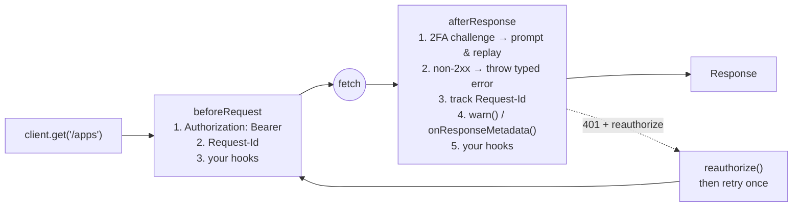

# heroku-fetch

A small, `fetch`-based HTTP client for Heroku's APIs, for Node.js and the browser.

You give it a path and it gives you back a standard `Response`. In between, it
takes care of the Heroku-specific details every API caller otherwise writes by
hand:

- **Service hosts and headers.** Pick a service (`platform`, `data`, `metrics`,
  …) and the client uses the right base URL and the right
  `Accept: application/vnd.heroku+json; version=3` header. It also honors the
  usual host-override environment variables, and validates them.
- **Authentication.** Takes a bearer token from a string, a function, or
  `HEROKU_API_KEY`. It can refresh and retry once on a 401, and answers 2FA
  challenges by prompting for a code and replaying the request.
- **Typed errors.** Any non-2xx response is thrown as a `HerokuApiError`
  subclass, with the parsed Heroku error body (`id`, `message`, `resource`)
  already attached.
- **Request correlation and warnings.** Sends and accumulates `Request-Id`
  headers across a session, and passes server `x-heroku-warning` headers to
  your code (deduplicated).
- **Proxies on Node.** Honors `HTTP_PROXY` / `HTTPS_PROXY` / `NO_PROXY`.
- **Safe debug logging.** `DEBUG=heroku:fetch:*` traces requests with tokens
  and other secrets redacted.

For typed methods generated from the API schema, use
[`@heroku/sdk`](https://github.com/heroku/heroku-sdk), which is built on this
package.

## Installation

```bash
npm install @heroku/heroku-fetch
```

Requires Node.js 22 or newer. The package is ESM-only.

`@heroku/heroku-cli-util` is an optional dependency. It powers the built-in
terminal 2FA prompt on Node (see [Two-factor authentication](#two-factor-authentication)).

## Quick start

```typescript
import {HerokuApiClient} from '@heroku/heroku-fetch'

// Platform API at https://api.heroku.com, token read from HEROKU_API_KEY
const client = new HerokuApiClient()

const response = await client.get('/apps')
const apps = await response.json()

await client.patch('/apps/my-app', {maintenance: true})
```

## How it works

Three things shape how you use the client:

1. **One client per service.** A `HerokuApiClient` is bound to one base URL
   when you create it. To talk to the Platform API and the Data API, create
   two clients. Paths are joined onto that base URL, so pass paths
   (`/apps/my-app`), not absolute URLs. To call a URL the API handed back
   (such as a `logplex_url`), create a `custom` client for that origin. See
   [Streaming](#streaming).
2. **You get a `Response` back, or an error is thrown.** Every method resolves
   to the standard Fetch `Response` on a 2xx. You call `.json()`, `.text()`, or
   read `.body` yourself. Any non-2xx response rejects with a typed error, so a
   `Response` you receive is always a success.
3. **The client is long-lived and stateful.** Each client keeps its own
   `Request-Id` chain, its set of already-shown warnings, and a shared
   in-flight 401 refresh. Reuse one client for a unit of work (a CLI command,
   a request handler) rather than creating one per call.

### Request pipeline

Each call runs through a fixed set of built-in hooks. Your own hooks run
after them.



What the ordering means for you:

- Your `beforeRequest` hooks see a request that is fully prepared, auth
  included, and can override any of it.
- Your `afterResponse` hooks, `warn`, and `onResponseMetadata` only see
  **successful** responses, because errors have already been thrown by the
  time they run.
- The client does not retry automatically, apart from the single 2FA replay
  and the single `reauthorize` retry. A 5xx or 429 is thrown on the first
  attempt.

### Entry points

| Import | What you get |
| --- | --- |
| `@heroku/heroku-fetch` (Node) | The client, the error classes, and `cliTwoFactorPrompt` / `createCliTwoFactorPrompt` |
| `@heroku/heroku-fetch` (bundler with the `browser` condition) | The client and the error classes only. There are no CLI helpers, nothing is read from `process.env` by default, and no `User-Agent` is set |
| `@heroku/heroku-fetch/client/environment-defaults.js` | `getDefaultFetch()`: the proxy-aware `fetch` the client uses on Node, for use with other libraries |

Your bundler resolves the right build for you; you don't import the browser
build by path. The types are identical in both builds.

## Services

| `service` | Default base URL | Override env var | Default `Accept` |
| --- | --- | --- | --- |
| `platform` (default) | `https://api.heroku.com` | `HEROKU_PLATFORM_HOST` | Heroku v3 |
| `data` | `https://api.data.heroku.com` | `HEROKU_DATA_HOST`, then `HEROKU_POSTGRESQL_HOST` | Heroku v3 |
| `metrics` | `https://api.metrics.heroku.com` | `HEROKU_METRICS_HOST` | Heroku v3 |
| `particleboard` | `https://particleboard.heroku.com` | `HEROKU_PARTICLEBOARD_URL` | Heroku v3 |
| `notifications` | `https://telex.heroku.com` | `HEROKU_NOTIFICATIONS_HOST` | none |
| `repositories` | `https://kolkrabbi.heroku.com` | `HEROKU_REPOSITORIES_HOST` | none |
| `custom` | `baseUrl` is required | none | none |

```typescript
const data = new HerokuApiClient({service: 'data'})
const db = await (await data.get(`/client/v11/databases/${addonId}`)).json()

const internal = new HerokuApiClient({service: 'custom', baseUrl: 'https://my-service.herokai.com'})
```

An explicit `baseUrl` always wins over both the service default and the
environment variable. You're responsible for validating any `baseUrl` you pass.

**Environment host validation.** Host override variables are read when a
client is created. The value must point at an approved host, or creating the
client throws:

- The host must be `heroku.com`, `herokai.com`, `herokuspace.com`,
  `herokudev.com`, a subdomain of one of these, or `localhost` / `127.0.0.1` /
  `[::1]`. `*.herokuapp.com` is **not** accepted.
- The value must use `https://`. Plain `http://` is allowed only for loopback
  hosts.
- A bare hostname gets `https://` added. The value must not include
  credentials, a path, a query, or a fragment.

**Targeting another environment.** heroku-fetch doesn't read the CLI's
`HEROKU_HOST`. Point `platform` at another environment with
`HEROKU_PLATFORM_HOST` (for example `api.staging.herokudev.com`) or an
explicit `baseUrl`. Credentials are looked up per host, so pass the same host
to `getAuth()` when you resolve the token:

```typescript
const host = 'api.staging.herokudev.com'
const {token} = await getAuth('you@example.com', host)
const client = new HerokuApiClient({baseUrl: `https://${host}`, token})
```

## Authentication

### Tokens

`token` accepts a string or a function (sync or async) that returns a token.
The function is called on **every** request, so it can return a rotated token
without you rebuilding the client.

```typescript
// Static token
new HerokuApiClient({token: process.env.MY_TOKEN})

// Resolved per request
new HerokuApiClient({token: async () => vault.get('heroku-token')})

// Send no Authorization header at all
new HerokuApiClient({token: ''})
```

When `token` is omitted (or `undefined`):

- **Named services** (`platform`, `data`, …) on Node read `HEROKU_API_KEY` on
  each request. In the browser, no token is sent.
- **`custom` clients** send no token, because their host may be outside
  Heroku. To authenticate one, pass `token` explicitly.

If no token is available, the request goes out without auth, and endpoints
that require auth throw `AuthenticationError`.

### Using Heroku CLI credentials

heroku-fetch doesn't read `~/.netrc` or the OS credential store. Resolve a
token with
[`@heroku/heroku-credential-manager`](https://github.com/heroku/heroku-credential-manager)
and pass it in:

```typescript
import {getAuth} from '@heroku/heroku-credential-manager'

// Passing the account reads the native credential store (Keychain, libsecret,
// Windows Credential Manager). Passing `undefined` reads ~/.netrc by host only.
const {token} = await getAuth('you@example.com', 'api.heroku.com')
const client = new HerokuApiClient({token})
```

### Refreshing on 401 (`reauthorize`)

Give the client a `reauthorize` callback and a 401 no longer fails straight
away. The client awaits your callback, then retries the request **once**,
calling your `token` function again.

```typescript
let token = await loadToken()

const client = new HerokuApiClient({
  token: () => token, // must be a function so the retry picks up the new value
  async reauthorize({signal}) {
    token = await runLogin({signal})
  },
})
```

- Concurrent 401s are combined into one `reauthorize` call, so ten parallel
  requests that share a stale token trigger one login, not ten.
- If the callback throws, that error propagates, with the original
  `AuthenticationError` attached as `cause`.
- A second 401 on the retry propagates. The client never loops.
- To opt a single request out, pass `{reauthorize: false}`. Do this when a 401
  from that endpoint doesn't mean "your Heroku token expired", or when
  replaying a write against a non-Platform host could repeat a side effect.

### Two-factor authentication

When the API answers with a 2FA challenge (a 412, or a 403 with id
`two_factor`), the client calls `twoFactor.onChallenge()` for a code. It then
replays the request with a `Heroku-Two-Factor-Code` header. A wrong code, or
having no handler, surfaces as `TwoFactorRequiredError`.

- **Node default:** a masked terminal prompt
  (`cliTwoFactorPrompt`, via `@heroku/heroku-cli-util`).
- **Browser default:** no handler.
- **Custom:**

```typescript
import {HerokuApiClient, createCliTwoFactorPrompt} from '@heroku/heroku-fetch'

new HerokuApiClient({twoFactor: {onChallenge: () => askUserForCode()}})
new HerokuApiClient({twoFactor: {onChallenge: createCliTwoFactorPrompt({message: 'Heroku 2FA code'})}})
```

## Making requests

| Method | Signature |
| --- | --- |
| `get` | `get(path, options?)` |
| `delete` | `delete(path, options?)` |
| `post` / `put` / `patch` | `post(path, body?, options?)` |
| `stream` | `stream(path, options?)`: a `GET` for long-lived responses |

Request bodies are always JSON-serialized. Per-request `options`:

```typescript
await client.get('/apps/my-app/releases', {
  headers: {Range: 'version ..; order=desc, max=10'}, // merged over client headers
  searchParams: {limit: 10},
  timeout: 5_000,             // ms, or false for none; overrides the client default (30_000)
  signal: controller.signal,  // abort this request
  reauthorize: false,         // skip the 401 refresh for this call
})
```

`timeout` limits how long each attempt waits for the response to start. It
doesn't cover reading the body, so a long `stream()` isn't cut off. Pass
`false` for no timeout; `0` throws, because it would abort every request.

A client-level `signal` aborts every request the client makes. It is combined
with any per-request `signal` and the timeout, so whichever fires first aborts
the request. Aborting rejects with an `AbortError`:

```typescript
const controller = new AbortController()
setTimeout(() => controller.abort(), 2_000)

try {
  await client.get('/apps', {signal: controller.signal})
} catch (error) {
  if ((error as Error).name !== 'AbortError') throw error
}
```

## Streaming

`stream()` returns the `Response` without reading the body, so you can consume
`response.body` incrementally. The log-session URL the Platform API returns is
an absolute URL on another host, so it needs its own client.
`logplex_url` carries its own credentials, and a `custom` client sends no
Heroku token unless you give it one:

```typescript
const platform = new HerokuApiClient()
const session = await (await platform.post('/apps/my-app/log-sessions', {tail: true, lines: 100})).json()

const url = new URL(session.logplex_url)
const logplex = new HerokuApiClient({service: 'custom', baseUrl: url.origin})
const response = await logplex.stream(url.pathname + url.search)

const decoder = new TextDecoder()
for await (const chunk of response.body!) {
  process.stdout.write(decoder.decode(chunk, {stream: true}))
}
```

## Errors

Every non-2xx response is thrown as one of these classes:

| Class | When | Extra fields |
| --- | --- | --- |
| `AuthenticationError` | 401 | |
| `NotFoundError` | 404 | |
| `RateLimitError` | 429 | `retryAfter`: seconds to wait, from a `Retry-After` given in seconds or as a date; `undefined` if absent or unrecognized |
| `TwoFactorRequiredError` | 412, or 403 with id `two_factor`, that wasn't resolved | |
| `HerokuApiError` | any other non-2xx; base class of all the above | |

Every error carries `statusCode`, `response`, and, when the body was JSON,
`id`, `message`, `errors`, `resource`, and the full parsed `body`.

```typescript
import {HerokuApiError, NotFoundError} from '@heroku/heroku-fetch'

try {
  await client.get('/apps/nope')
} catch (error) {
  if (error instanceof NotFoundError) {
    console.error(`No such ${error.resource ?? 'resource'}`)
  } else if (error instanceof HerokuApiError) {
    console.error(`${error.statusCode} ${error.id}: ${error.message}`)
  } else {
    throw error // network failure, abort, timeout
  }
}
```

Network failures, aborts, and timeouts are not `HerokuApiError`s. They come
through as the underlying fetch or ky errors.

## Observability

```typescript
const client = new HerokuApiClient({
  // Identify your traffic. On Node, this sends
  // "my-tool/1.2.3 (darwin; arm64) Node.js/22.x". Ignored in browsers.
  userAgent: {name: 'my-tool', version: '1.2.3'},

  // Server x-heroku-warning / warning-message headers, each unique one shown once
  warn: message => console.warn(message),

  // Per-response request ids, status, url, and warnings (success path only)
  onResponseMetadata: ({requestIds, status, url}) => log.debug({requestIds, status, url}),
})
```

**Request-Id.** Every request carries a `Request-Id` header listing the ids
generated and echoed so far by this client, newest first, capped at about 7 KB.
Heroku support can use it to follow a multi-call operation from start to
finish.

**Debug logging** uses [`debug`](https://github.com/debug-js/debug). Values
that are logged are scrubbed of tokens, `Authorization` values, and other
credentials first. URLs keep their path, with credentials in the query string
removed. A `custom` client logs only the URL's origin, because the URLs it
calls (such as a log session's) can carry a credential in the path.

```bash
DEBUG=heroku:fetch:* node script.js
```

| Namespace | Logs |
| --- | --- |
| `heroku:fetch:request` | Method, URL, and the (redacted) request headers, as sent: after your hooks run, and again for a 2FA replay |
| `heroku:fetch:response` | Method, URL, and status |
| `heroku:fetch:auth` | Client setup (service and base URL), token attachment, 2FA, and `reauthorize` events |
| `heroku:fetch:error` | Parsed (redacted) error bodies |

In the browser, set `localStorage.debug = 'heroku:fetch:*'`.

## Customizing

```typescript
const client = new HerokuApiClient({
  headers: {'X-Origin': 'my-tool'},                   // sent on every request
  defaultAccept: 'application/vnd.heroku+json; version=3.sdk', // replaces the service Accept default
  hooks: {
    beforeRequest: [({request}) => { request.headers.set('X-Trace', traceId()) }],
    afterResponse: [({response}) => { metrics.count(response.status) }],
  },
})
```

Headers, hooks, the base URL, `defaultAccept`, and `twoFactor` are fixed when
you create the client. A few options can be changed afterward:

```typescript
client.setOption('token', newToken)  // also: 'timeout', 'signal', 'warn', 'onResponseMetadata'
```

Calling `setOption` with any other key throws rather than silently doing
nothing.

## Proxies (Node)

If `HTTP_PROXY`, `HTTPS_PROXY` (or their lowercase forms) are set, requests
are routed through undici's `EnvHttpProxyAgent`, which also honors `NO_PROXY`.
To reuse the same proxy-aware `fetch` with other libraries:

```typescript
import {getDefaultFetch} from '@heroku/heroku-fetch/client/environment-defaults.js'

const fetch = await getDefaultFetch()
```

## Environment variables

All of these are read on Node only. The browser build reads none of them.

| Variable | Effect |
| --- | --- |
| `HEROKU_API_KEY` | Default bearer token for named services, read on each request when `token` is omitted. Never sent by `custom` clients |
| `HEROKU_PLATFORM_HOST` | `platform` service host |
| `HEROKU_DATA_HOST`, `HEROKU_POSTGRESQL_HOST` | `data` service host |
| `HEROKU_METRICS_HOST` | `metrics` service host |
| `HEROKU_PARTICLEBOARD_URL` | `particleboard` service host |
| `HEROKU_NOTIFICATIONS_HOST` | `notifications` service host |
| `HEROKU_REPOSITORIES_HOST` | `repositories` service host |
| `HTTP_PROXY`, `HTTPS_PROXY`, `NO_PROXY` | Proxy routing |
| `DEBUG` | Debug log namespaces |

## Examples

- [`examples/basic-usage.ts`](examples/basic-usage.ts),
  [`examples/app-info.ts`](examples/app-info.ts): standalone scripts
- [`examples/oclif/`](examples/oclif/README.md): oclif commands for listing
  apps, app info, streaming logs, and `pg:info` across the Platform and Data
  APIs
- [`examples/ember-app/`](examples/ember-app/README.md): browser usage

## Contributing

See [CONTRIBUTING.md](CONTRIBUTING.md) and [TESTING.md](TESTING.md).

## License

Apache-2.0. See [LICENSE.txt](LICENSE.txt).
